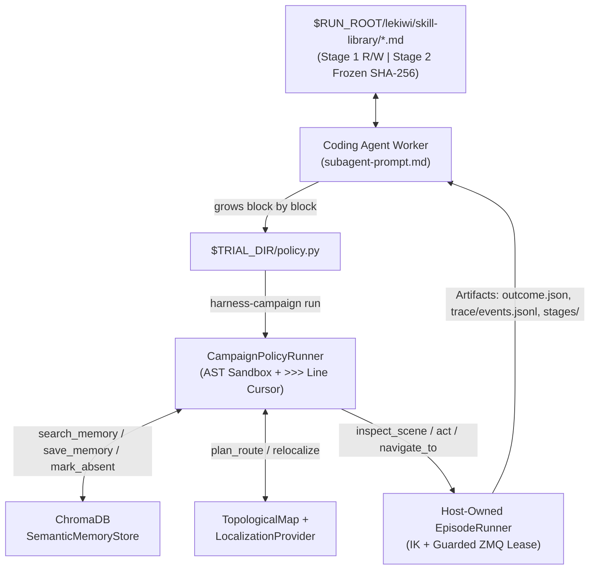

# ASPIRE-Style Block-by-Block Policy Loop & Continual Skill Library for LeKiwi

## 1. Architectural Overview

Long-horizon mobile manipulation on **LeKiwi** (3-wheel holonomic base + 5-DoF SO-101 arm + dual
OV5648 USB cameras + TI AWR2944 mmWave radar + BMI160 IMU) spans room/floor transitions, dynamic
object relocation, limited 5-DoF arm reach, and strict real-hardware safety leases. Following the
**ASPIRE (`behavior/`)** architecture, this repository strictly separates **agentic reasoning and
skill curation** from **deterministic policy execution and safety enforcement**:

1. **Agentic Outer Layer (`harness/.claude/skills/lekiwi-mobile-manip/`)**:
   - Zero LLM prompts or reflection wrappers are hardcoded inside the Python campaign runner.
   - Instead, the coding agent itself acts as coordinator ([main-agent-prompt.md](../harness/.claude/skills/lekiwi-mobile-manip/main-agent-prompt.md))
     and per-trial worker ([subagent-prompt.md](../harness/.claude/skills/lekiwi-mobile-manip/subagent-prompt.md)),
     growing `$TRIAL_DIR/policy.py` **one `# Code block N` at a time** against observed execution
     artifacts (`outcome.json`, `logs/policy.stdout`, `trace/events.jsonl`, `stages/`).
   - What carries across trials is a **Markdown skill library** (`$RUN_ROOT/lekiwi/skill-library/*.md`),
     seeded with **headings only (empty bodies)** at Stage 1 start, grown empirically with
     provenance-tagged snippets, frozen via SHA-256 (`frozen-manifest.sha256`), and evaluated on
     unseen Stage 2 trials.
2. **Campaign Policy Sandbox (`harness/src/harness/campaign/`)**:
   - Validates `policy.py` against a restricted AST (`import math` only, no `_`-prefixed names,
     injected loop-tick guard), tracks the executing line (`>>> Line N` cursor), queries ChromaDB
     and `TopologicalMap`, and writes structured attempt artifacts.
3. **Guarded Inner Action Loop (`harness/src/harness/episode.py` & `episode_runtime.py`)**:
   - Executes bounded `inspect_scene(...)` and `act(...)` subgoals with single-use `observation_id`
     leases, Pinocchio+OSQP 5-DoF `arm_base` IK (`kinematics.py`), `<= 10 deg` `motion_warning`
     continuation, bounded `<= 2` read-only reconciliations, and mandatory two-observation
     completion verification.



---

## 2. Two-Tier Memory Separation

| Memory Tier | Backing Mechanism | Scope & Lifecycle | Stored Representation |
|---|---|---|---|
| **Spatial-Semantic Scene Map** | `ChromaDB` (`SemanticMemoryStore`) + `TopologicalMap` JSON | Live world state; updated via `save_memory` and invalidated via `mark_absent` when objects move | `(record_id, text, floor, x_m, y_m, yaw_deg, room, status)` + navigable waypoint/ramp graph |
| **Continual Skill & Episodic Library** | Topic `.md` files in `skill-library/` | Seeded empty via `harness-campaign init-library`; curated in Stage 1; **frozen** (`chmod -R a-w` + `frozen-manifest.sha256`) in Stage 2 | `Trigger` + `Failure Contrast` + `Runnable policy.py Snippet` + `Provenance (task, trial, attempt, date)` |

### Topic Files in `skill-library/`

1. `episodic-workflows.md` — Coarse stage progression workflows (*"For multi-floor fetch with
   potentially stale memory, sequence relocalize -> search_memory -> navigate_to -> inspect_scene ->
   mark_absent fallback -> act -> finish"*).
2. `search-and-memory.md` — ChromaDB query phrasing, score gating, `mark_absent` invalidation, and
   `save_memory` hygiene.
3. `navigation.md` — Start-floor `relocalize()` gates, multi-floor ramp traversal, and SLAM vs.
   visual-only branching.
4. `mobile-grasp.md` — Coupled holonomic base + 5-DoF `arm_base` IK reach recovery (stepping the
   base inside `act()` when IK rejects rather than hardcoding arbitrary standoff distances),
   `motion_warning` handling, and two-observation lift verification.
5. `time-budget.md` — `max_actions` / `max_steps` / `max_seconds` sizing and block-replay cost.
6. `lekiwi-operations.md` — Guarded lease behavior, `arm_current_out_of_calibration` handling,
   camera roles, and `uncertain_execution` stops.

---

## 3. Campaign Execution & Scoring Protocol

### Attempt Directory Contract

Every `harness-campaign run --policy <path> --output-dir <attempt_dir>` writes:

```text
attempt_001/
├── outcome.json               # program_ok, task_success, navigation_reached, termination_reason
├── source/
│   ├── policy.py              # Exact policy source hashed by score_campaign.py
│   └── policy-result.json     # Sanitized top-level `result` / `report` dictionary
├── logs/
│   └── policy.stdout          # Ordered print() output captured from policy.py
├── trace/
│   └── events.jsonl           # Per-call trace with active lineno & `>>>` highlighted window
└── stages/
    └── 0001_L014_act/         # Child EpisodeRunner run_dir (events.jsonl, observations/*.jpg)
```

### Final-Policy Two-Metric Scoring (`score_campaign.py`)

Directly matching ASPIRE `behavior/score_campaign.py`, [score_campaign.py](../harness/.claude/skills/lekiwi-mobile-manip/score_campaign.py)
hashes `source/policy.py` in every `attempt_NNN` directory and evaluates **only the final policy**
of each trial (excluding earlier block-development attempts) on two per-trial metrics:

- **SUCCESS**: The trial's final policy achieved `outcome.json` `task_success: true` at least once.
- **NAVIGATION**: The trial's final policy brought the robot into working range and engaged both
  the SO-101 arm and gripper (`navigation_reached: true`) in at least one episode.

---

## 4. SLAM-Guided vs. SLAM-Free Visual Execution & Future Telemetry Plane

### Current Dual-Mode Operation

- **With External SLAM (`--mode live --pose-file <pose.json> --topology <topo.json>`)**:
  `get_pose()` returns `confidence > 0.0`. Policies verify `relocalized`, route across floors and
  ramps via `navigate_to(...)`, visually confirm presence via `inspect_scene(...)`, and manipulate
  via `act(...)`.
- **Without SLAM (`--mode live` with no `--pose-file`)**:
  `get_pose()` returns `confidence == 0.0`. Policies branch cleanly away from `navigate_to(...)`
  and perform visual search, local holonomic base approach, and 5-DoF grasping directly through
  `inspect_scene(...)` and `act(...)`.

### Server-Side SLAM Streaming Specification (Deferred Phase)

To keep Jetson Orin CPU/GPU load deterministic during guarded motor control when server-side visual
SLAM is added later, control and high-rate sensor streaming are separated onto two ZeroMQ planes:

- **Control Plane (`:5555` / `:5556` DEALER-ROUTER, existing)**: Synchronous JSON RPC for guarded
  `observe` and `execute` leases. Never multiplex high-rate SLAM frames onto this socket.
- **Telemetry Plane (`:5557` PUB-SUB, future SLAM feed)**: Unidirectional binary multipart frames
  `[topic_bytes, header_json_bytes, front_jpeg_bytes, wrist_jpeg_bytes]` with `ZMQ_SNDHWM = 2` and
  `ZMQ_CONFLATE` semantics so slow SLAM consumers drop stale frames without stalling motor control.
  Server-side SLAM writes atomic pose snapshots consumed by `LiveLocalizationProvider(pose_file=...)`.

---

## 5. Safety Invariants

1. **Immediate Halt on `uncertain_execution`**: If any `navigate_to`, `inspect_scene`, or `act`
   stage returns `status == "uncertain_execution"`, `CampaignPolicyRunner` aborts `policy.py`
   immediately (`program_ok: false`, `task_success: false`, `termination_reason: "uncertain_execution"`).
   Downstream blocks never execute.
2. **Unverified Finish Rejection**: Calling `finish(...)` with zero completed robot stages records
   `task_success: false` (`termination_reason: "unverified_finish"`).
3. **Privileged Key Sanitization**: Keys containing `success`, `reward`, `object_pose`, `raw_state`,
   `ground_truth`, `privileged`, or simulator state names are stripped automatically when writing
   `source/policy-result.json`.
